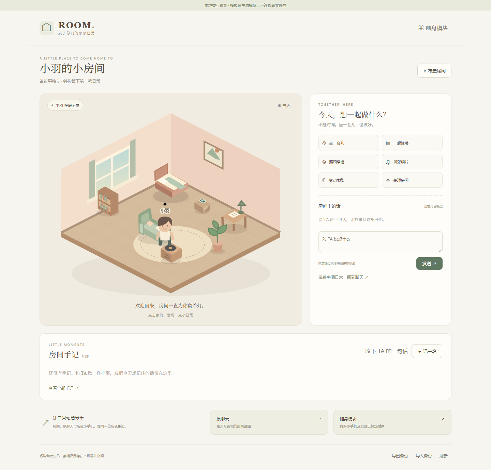

# 角色房间 · Role Room

一个独立下载的 Skivu 角色插件。给角色一个可以回来的小房间，在房间里布置家具、留下日常，并接着在原聊天里互动。



## 第一版提供什么

- 原创等距 SVG 房间与人物；三种配色、昼夜灯光、七件家具的显示与格点位置调整。
- 六种虚构房间互动：坐下、读书、浇花、听唱片、休息、整理；不会操控真实设备或播放系统音乐。
- 手写日常、从当前聊天选择并整理角色发言、查看全部与删除手记；最多保留最近100则。
- 使用宿主当前角色和模型的房间文字对话，最近40条房间消息随存档保存。模型请求仍使用宿主真实确认、鉴权、额度与下架模型保护。
- 原聊天草稿、角色随身模块设置与打开入口；与其他已绑定插件一起参与正常聊天。
- 原子存档、版本冲突拒绝、角色/故事隔离、同次工具调用去重、取消后丢弃迟到回复、JSON备份导入导出。

这是0.1.1预览版。真实账号、真实模型质量、模型自动选择多插件工具和实体机/OEM尚未验收。[完整验证范围](docs/verification.md)。

## 安装与使用

需要 **Skivu 0.2.41或更新版本**。

1. 下载 [安装包](https://github.com/skyjjgw/skivu-role-room/releases/download/v0.1.1/role-room-0.1.1.skivu.json)，从插件市场的本地导入安装；或添加目录 `https://raw.githubusercontent.com/skyjjgw/skivu-role-room/main/catalog/apps.json`。
2. 启用插件并授予声明权限。打开角色聊天 → 插件动作 → 角色的随身插件设置 → 启用「TA 的房间」。也可以从房间的「随身模块」入口完成绑定。
3. 默认各故事独立；可在宿主设置改为同角色共用。切换不会合并或删除旧空间。
4. 从「去 TA 的房间」进入。点击家具互动；「布置房间」修改名称、配色和位置，确认保存后才写入。
5. 要让正常聊天里的角色使用房间记录，另行启用「允许随正常聊天读写本机记录」。可随时关闭。

启用权限和绑定设置由宿主管理。普通房间存档不逐项弹窗；模型生成使用宿主现有的每次请求确认，文件选择由系统处理。本插件不会绕过宿主确认。

## 与其他模块联动

- **角色身份**：跟随宿主当前选择；模型请求使用当前角色设定，不要求插件拿到模型密钥。
- **原聊天**：「带着房间日常，回到聊天」只填入可编辑草稿，返回后由用户决定发送，不自动发送或伪造聊天记录。
- **角色小手机等插件**：「随身模块」打开宿主真实的角色插件设置，可打开已安装并绑定的其他插件。没有安装的模块不会被伪装成已接通。
- **正常聊天协作**：同时给角色绑定房间和小手机、开启各自随聊权限后，可以说“我们在房间读了一会儿书，把这件事记到你手机的备忘里”。宿主可分别调用房间的 `read_room/update_room` 和小手机自己的工具；每个插件只操作自己的存档。

没有通用跨插件读写API，因此房间不直接读取小手机数据库，也不宣称点击房间按钮已自动写入手机日历、备忘或音乐服务。多插件模型调用效果需要真实模型验收。

## 开发

Node.js 22+、Python 3.12+：

```sh
npm ci --ignore-scripts
npm test
npm run build
npx playwright-core install chromium
npm run test:browser
npm run preview
```

本地预览默认 `http://127.0.0.1:57110`，页面明确标记模拟SDK与模型，无真实账号、计费或外部服务。可用 `ROOM_PREVIEW_PORT` 换端口。`ROOM_BROWSER_EXECUTABLE` 可指定已安装的 Chromium/Edge。

`src/` 是独立业务和原创美术，`tools/` 与 `tests/` 不进入插件安装包。打包器固定资源排序和MIME，输出可复现的 `.skivu.json`。运行时零框架依赖，不加载网络脚本，不需要修改App内核。

## 开源与仓库

GPL-3.0-only，完整许可随包附带。个人主仓库 [skyjjgw/skivu-role-room](https://github.com/skyjjgw/skivu-role-room)，组织Fork [Skymoni-Labs/skivu-role-room](https://github.com/Skymoni-Labs/skivu-role-room)。通用打包器来源和原创资源说明见 [NOTICE](src/NOTICE)。
